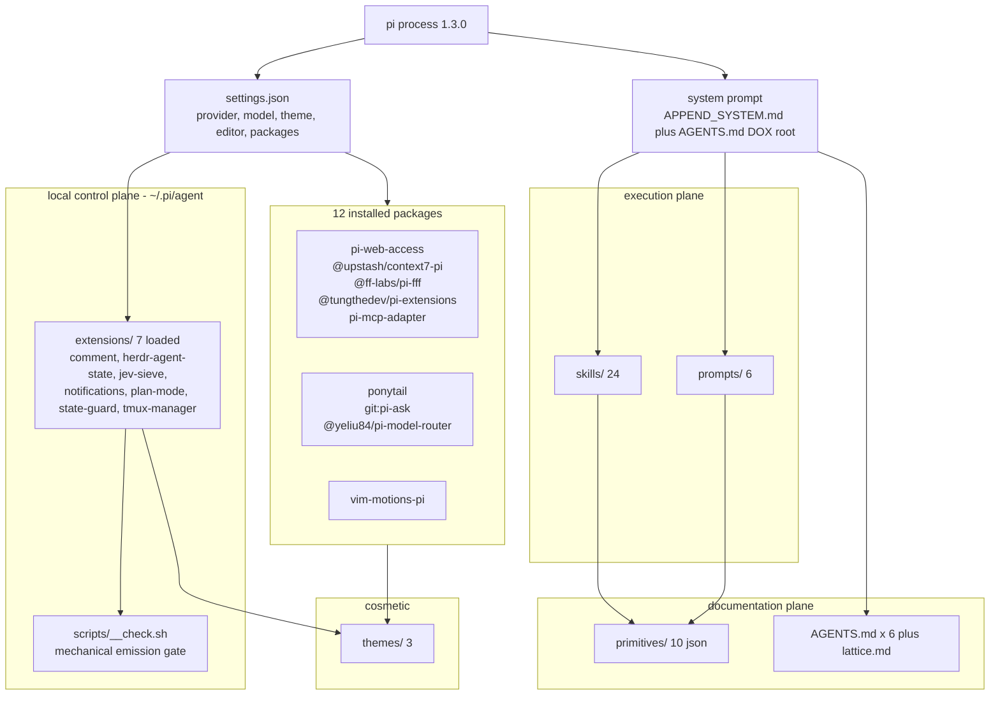
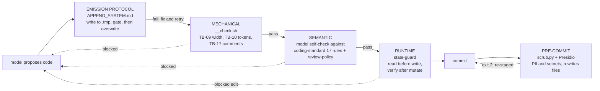
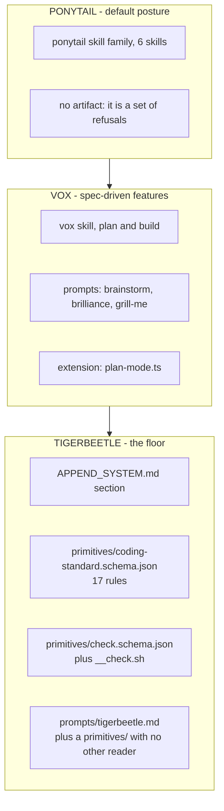
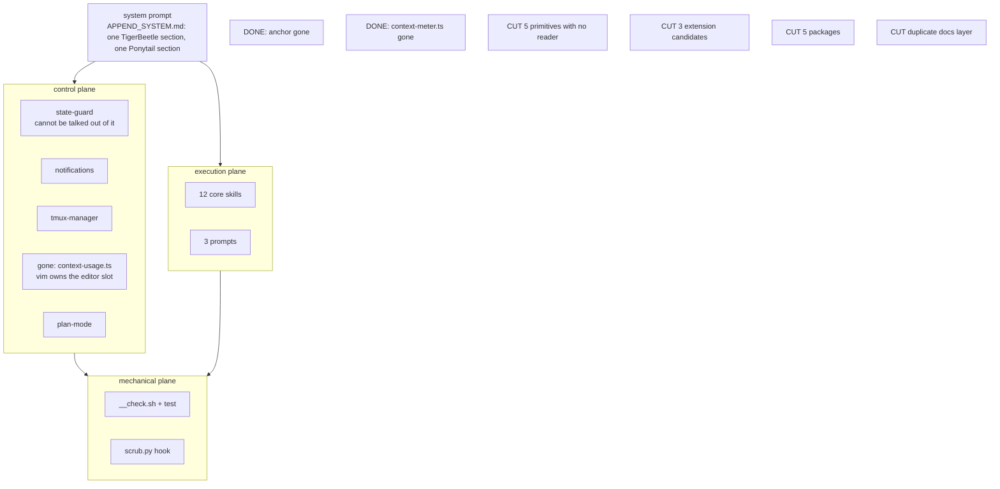

# Harness map

Drawn 2026-10-17 from the live tree at `~/.pi/agent` (pi 1.3.0), not from memory or docs.

The files under `/home/m0xu/recovery-2026-10-17/` are unrelated to this map.
They are recovery candidates from the merge incident: diffs of work the transcripts hold,
applied or skipped one by one. Delete the directory once you have reviewed it.

## Read this first

Three numbers describe the whole harness:

| Layer | Count | What it is |
|---|---|---|
| system prompt | 2 | `APPEND_SYSTEM.md` + `AGENTS.md` (DOX root) |
| control plane | 7 extensions + 9 packages | lifecycle hooks that act on the agent loop |
| execution plane | 24 skills + 6 prompts | text the model follows |
| documentation plane | 10 primitives + 6 AGENTS.md | JSON schemas and DOX contracts describing the above |
| mechanical plane | 2 scripts + 1 hook | `__check.sh` and the Presidio pre-commit scrub |

## 1. What pi loads

## 2. The chain that gates a code change

Every gate below is a different mechanism with a different failure mode.
This is the part worth keeping.

Where each gate can lie to you:

- **EMISSION PROTOCOL** is a prompt instruction. Nothing enforces it.
  An agent that skips the `.tmp` step is invisible.
- **MECHANICAL** is real code, but line-anchored regex: it sees comment markers and `TODO` strings, not intent.
- **SEMANTIC** is the model grading itself, in the same context that produced the code.
- **RUNTIME** is the only gate that cannot be talked out of a decision, because it is a
  `tool_call` handler in the pi process.
- **PRE-COMMIT** is the only gate that fires after the agent has stopped, and the only one
  that never sees the reasoning.

## 3. The three tiers, and where each actually lives

TigerBeetle is currently described in four places: the system prompt section,
`coding-standard.schema.json`, `prompts/tigerbeetle.md`, and `check.schema.json`.
They do not agree on the rule count.
The system prompt lists 10 floor rules, `coding-standard.schema.json` now says 17 after recovery,
`prompts/tigerbeetle.md` said 14 and now says 17, and `check.schema.json` enumerates a different
subset again.

## 4. Proposed shape

Same functions, fewer moving parts. Everything marked CUT has an evidence line under the diagram.

**Executed 2026-10-17:** `anchor` (both skills, the generator, the hook template) and
`context-meter.ts` are deleted, and the TigerBeetle rule list now has one home. The rest of the
table is still a proposal.

### Cuts and the evidence

| Cut | Evidence |
|---|---|
| **CUT, done: anchor** (`anchor-init`, `anchor-verify`, hook, manifest) | Two skills, a `generate_manifest.py`, and a pre-commit hook. The hook was installed in **zero** repos: both repos that ran it (`testudo`, `LoveByCartiana`) have `.anchor/` but their `.git/hooks/pre-commit` is the PII scrub, with no anchor line. It produced artifacts and no gate. |
| **CUT, done: `context-meter.ts`** | Rendered `setWidget("sys", ...)` above the editor; `context-usage.ts` renders the same context numbers as a status segment. Both hooked `session_start`. Kept `context-usage.ts`, which is the one the index documents. |
| **5 primitives** | Exact-filename reference counts: `adr` 3, `decision-tree` 4, `glossary` 3, `project-context` 6, `review-result` 3. Each is referenced only by `primitives/AGENTS.md`, itself, and one prompt or skill. `spec.schema.json` (5) and `coding-standard` (3) are the only ones with real readers. |
| **3 extensions** | `comment.ts` exists to paste a `#`-prefixed comment into the editor; `jev-sieve.ts` calls a local model to censor tool output, with a cache and a retention policy; `plan-mode.ts` writes a `PLAN.md` that the vox workflow and `.specify/` already cover. |
| **Not a cut: `herdr-agent-state.ts`** | Used occasionally, so it stays. It is also vendor-managed: its own header says `installed by herdr` and `reinstalling or updating the integration overwrites this file`, so removing it from here would not survive that integration anyway. The map keeps it out of the cut list on purpose, because a stale proposal is the drift this pass exists to remove. |
| **CUT, done: 3 theme packages** | Whole packages removed: `pi-ansi-themes`, `pi-themes`, `pi-blackboard-theme`. The active theme `vanilla-amoled` is a local file in `themes/`, so none of the three shipped anything in use. |
| **Kept, by decision: `model-router`** | Per-turn routing through `model-router.json`. Removing it would make `settings.json` the only model authority; you kept it, so `settings.json` and `model-router.json` both stay. |
| **Resolved: the editor slot** | `vim-motions-pi` loads last, so it wins `setEditorComponent` and the boxed editor never installs. Dropping the boxed editor is not an option: `@tungthedev/pi-extensions` also provides the Task subagents, todos, goal, workspace, mermaid, and shell. So vim keeps the slot, and `context-usage.ts` plus `settings.json`'s `editor` block are gone, because only `@tungthedev` listens for the event `context-usage.ts` emitted. |
| **duplicate docs** | `primitives/`, `lattice.md`, 6 `AGENTS.md` files, and `extensions/AGENTS.md` all restate boundaries that the system prompt also states. Three of them were already out of date (`extensions/AGENTS.md` lacked `context-meter.ts`; `lattice.md` lacked the state-guard). |

### Keep, and make it the spine

The one gate that survived every incident in this session is the mechanical one,
because it is the only gate that is code plus a test: `__check.sh` and `__check.test.sh` (15 tests).

If TigerBeetle is the style guide, the shape follows:

1. One rule list, in one file, at one version. `coding-standard.schema.json` is the best
   candidate; delete the count from the system prompt and from `prompts/tigerbeetle.md` and
   reference the file instead.
2. Every rule is either mechanical (a `__check.sh` check with a test) or named as
   unenforceable. Today 3 of 17 are mechanical, and the other 14 rest on the model grading
   itself, which is what the harness keeps failing at.
3. Move the enforcement that matters out of prompts and into `tool_call` handlers, the way
   `state-guard` does. A handler is the only place a rule has teeth.

## 5. What the cuts changed in the rule spine

The rule list now has one home: `primitives/coding-standard.schema.json` (17 rules).
`APPEND_SYSTEM.md` keeps the eight rules that change behavior most often and points at the file;
`prompts/tigerbeetle.md` no longer carries a copy of the table.

Two things the gate does to your own docs, both found while verifying this change:

- `__check.sh APPEND_SYSTEM.md` flags line 212 for a prohibited token. The token is the word
  `TODOs` in the Ponytail section. The gate is line-anchored regex, so prose trips it.
- The same file trips TB-09 in nine places. Markdown tables and long sentences cannot fit inside
  100 columns, so the width rule only makes sense for code.

The remaining duplicate is small and deliberate: `primitives/check.schema.json` still names the
three mechanical rule IDs, because it defines the gate's protocol. Everything else derives.
