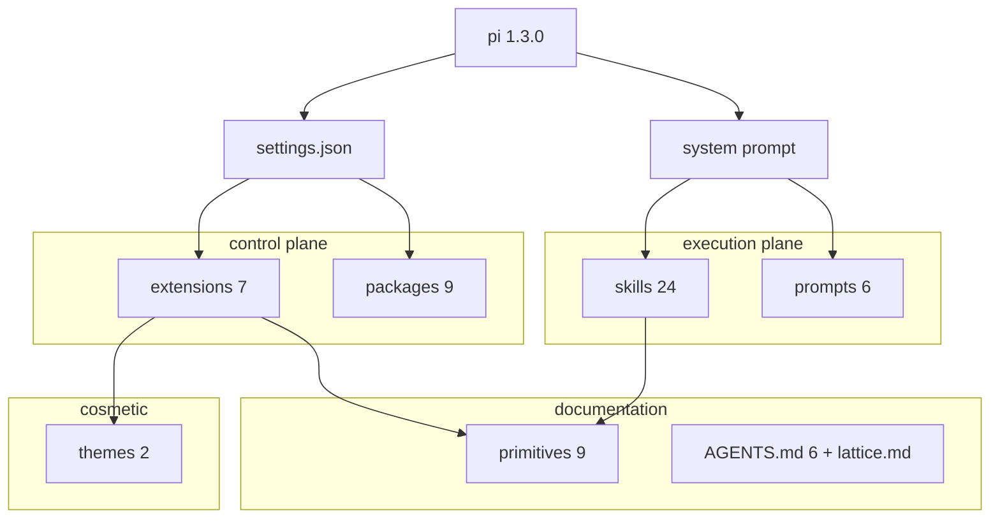
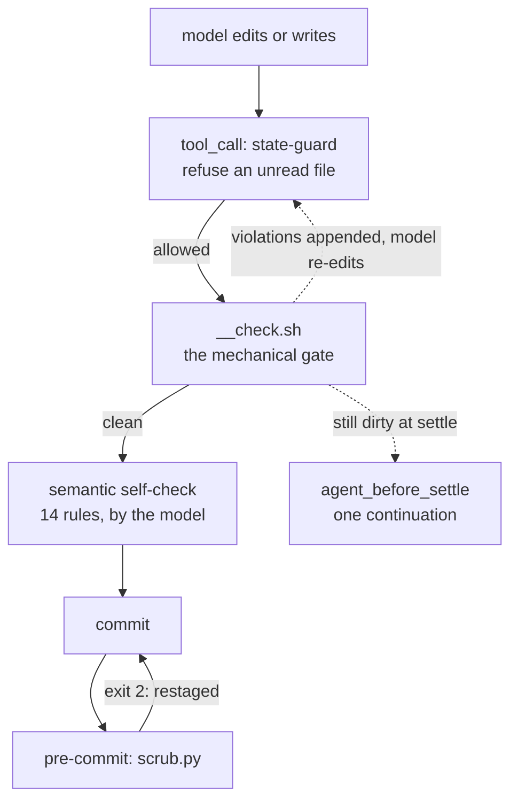
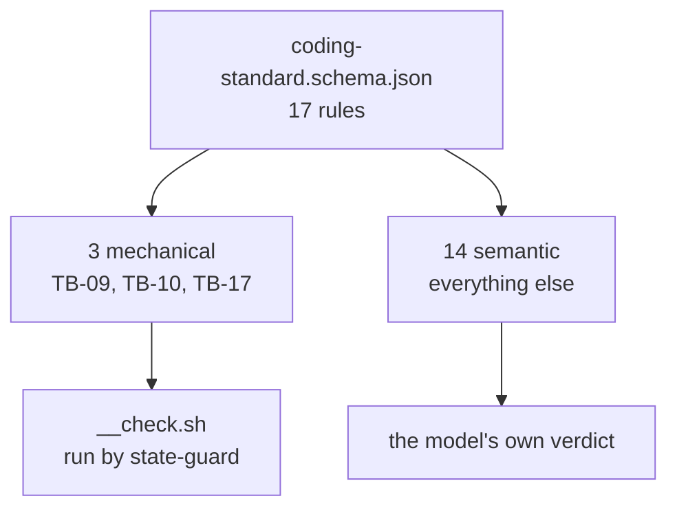
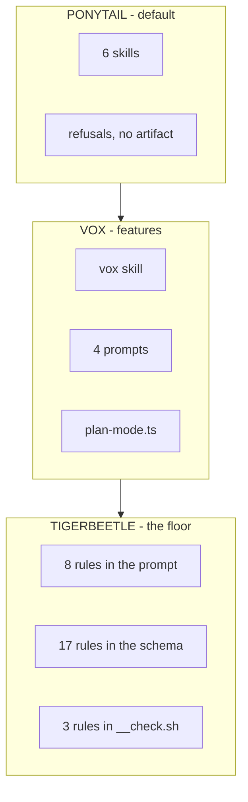
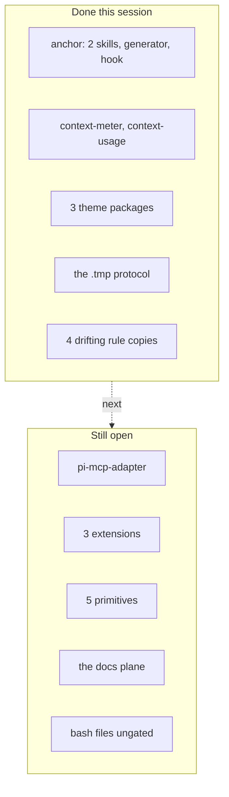

# Harness map

Drawn 2026-10-17 from the live tree at `~/.pi/agent` (pi 1.3.0), not from memory or docs.
Every count was read off disk at draw time, and every diagram below was rendered to check it,
not eyeballed. Regenerate with:

```bash
node scripts/__render-diagrams.mjs harness-map.md ../diagrams
```

The files under `/home/m0xu/recovery-2026-10-17/` are unrelated to this map: they are recovery
candidates from the merge incident. Delete them once reviewed.

## Read this first

| Layer | Count | What it is |
|---|---|---|
| system prompt | 2 files | `APPEND_SYSTEM.md` + `AGENTS.md` (DOX root) |
| control plane | 7 extensions + 9 packages | code that acts on the agent loop |
| execution plane | 24 skills + 6 prompts | text the model follows |
| documentation plane | 9 primitives + 6 `AGENTS.md` + `lattice.md` | schemas and DOX contracts describing the rest |
| mechanical plane | 1 gate + 1 test + 1 hook | `__check.sh`, `__check.test.sh`, `scrub.py` |

## 1. What pi loads

Structural only. The membership of each box is in the table underneath, so the diagram stays
readable in a terminal.



| Box | Members |
|---|---|
| extensions 7 | `comment`, `herdr-agent-state`, `jev-sieve`, `notifications`, `plan-mode`, `state-guard`, `tmux-manager` |
| packages 9 | `pi-web-access`, `@upstash/context7-pi`, `@ff-labs/pi-fff`, `@tungthedev/pi-extensions`, `pi-mcp-adapter`, `@yeliu84/pi-model-router`, `ponytail`, `git:pi-ask`, `vim-motions-pi` |
| skills 24 | `adr`, `appimage-integrate`, `audit`, `bridge-recon`, `cloudflare-devops`, `cover-letter`, `diff-review`, `ffmpeg-composite`, `graphify`, `handoff`, `humanizer`, `nuclear-review`, `onchain`, `project-orientation`, `prolong`, `scythe`, `shannon`, `ste-writing`, `teach`, `typesafe-ai`, `vault-context`, `video-render-qa`, `vox`, `yt-dlp-download` |
| prompts 6 | `brainstorm`, `brilliance`, `grill-me`, `grill-with-docs`, `scythe-cutlist`, `tigerbeetle` |
| primitives 9 | `adr`, `check`, `coding-standard`, `decision-tree`, `glossary`, `project-context`, `review-policy`, `review-result`, `spec` |

One box is a lie: `pi-mcp-adapter` is declared in `settings.json` with nothing installed behind it.
`npm/node_modules/pi-mcp-adapter` is gone while a dangling `npm/node_modules/.bin/pi-mcp-adapter`
symlink to `../pi-mcp-adapter/cli.js` remains, and pi reacted to the declaration by writing
`extensions: ["-builtin:mcp"]` into `settings.json`, which switches off pi's own MCP support. No
MCP tools exist in a session.

## 2. The gate chain



Read the spine top to bottom. The two dotted edges are the loops: the gate sends the model back to
re-edit, and an unfinished turn gets exactly one continuation.

Where this can still fail:

- The gate runs on `edit` and `write` only. A file created by a `bash` heredoc is never inspected.
  This is the largest remaining hole.
- The gate is regex, so it sees tokens rather than intent. `@waiver` is the release valve.
- The semantic step is the model grading itself, in the same context that wrote the code.
- The pre-commit hook is the only gate that runs after the agent has stopped.

## 3. The rule spine

One file owns the rules. Nothing else enumerates them or their counts.



`APPEND_SYSTEM.md` keeps the eight rules that change behavior most often and points at the file.
`prompts/tigerbeetle.md` keeps the protocol and no table. `check.schema.json` keeps the protocol
and no rule IDs. The four copies that had drifted to 10, 14, 16, and 17 rules are gone, and each
rule now states its own `enforcement` and `enforcedBy`.

## 4. Where the three tiers live



## 5. Done and open



| Open item | Evidence |
|---|---|
| `pi-mcp-adapter` | Declared, package directory absent, dangling bin symlink, `builtin:mcp` disabled by pi in response. Install it or delete the declaration. |
| `comment.ts` | Exists to paste a `#`-prefixed comment into the editor. |
| `jev-sieve.ts` | Calls a local model to censor tool output, with a cache and a retention policy. No evidence it runs. |
| `plan-mode.ts` | Writes a `PLAN.md` that the vox workflow and `.specify/` already cover. |
| 5 primitives | Exact-filename reference counts: `adr` 3, `decision-tree` 4, `glossary` 3, `project-context` 6, `review-result` 3. Each is referenced only by `primitives/AGENTS.md`, itself, and one prompt or skill. |
| docs plane | `lattice.md` plus 6 `AGENTS.md` files restate boundaries the system prompt already states. Three were stale before this session. |
| bash files ungated | The `tool_result` handler sees `edit` and `write`. A `bash` heredoc writes a file nothing inspects. |

Two decisions recorded so the next pass does not re-litigate them:

| Kept | Reason |
|---|---|
| `herdr-agent-state.ts` | In use. Also vendor-managed: its own header says reinstalling the Herdr integration overwrites the file, so removing it here would not survive anyway. |
| `@yeliu84/pi-model-router` | Per-turn routing through `model-router.json`. Removing it would make `settings.json` the only model authority. |

## 6. What verifying this pass turned up

- `__check.sh` used to grade Markdown as code: `APPEND_SYSTEM.md` tripped TB-10 on the word
  `TODOs` in prose, and TB-09 nine times on table rows that cannot wrap. Markdown now gets MD-01
  (unclosed fence, unbalanced mermaid) and JSON gets JSON-01 (validity), and both are tested.
- Writing those tests made the gate flag its own test file, because the fixtures embedded the
  tokens and comment headers under test. The fixtures now build content with `printf` and split
  `"TO" "DO"`, so the file no longer contains what it forbids.
- A live run showed the gate cannot be skipped: the transcript holds
  `[state-guard] __check.sh rejected /tmp/sg-gate/bad2.ts:` in the tool result, and the settle
  nudge naming `TB-10 line 1` and `TB-17 line 1`.
- Twice a model refused to satisfy a test that required writing a violation. The first refused to
  write the `TODO` at all; the second wrote it, then declined to fix it because the instruction
  and the nudge disagreed, and flagged the contradiction instead. Both are the harness working.
